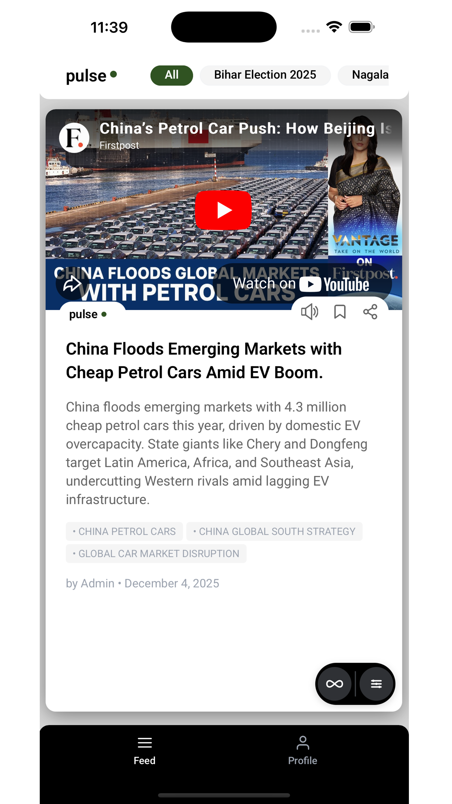
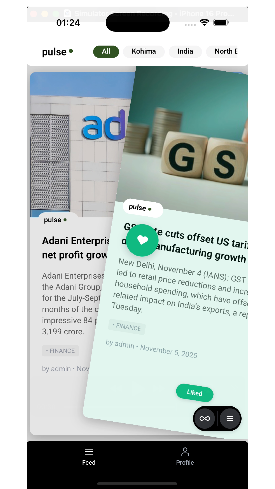
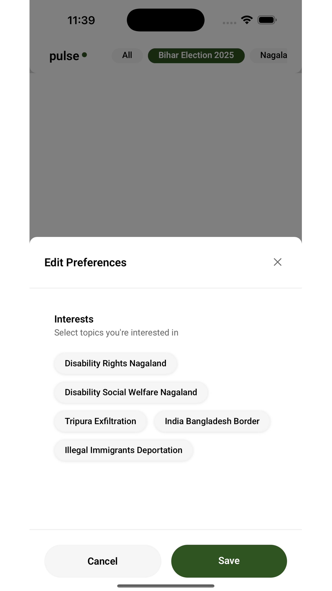
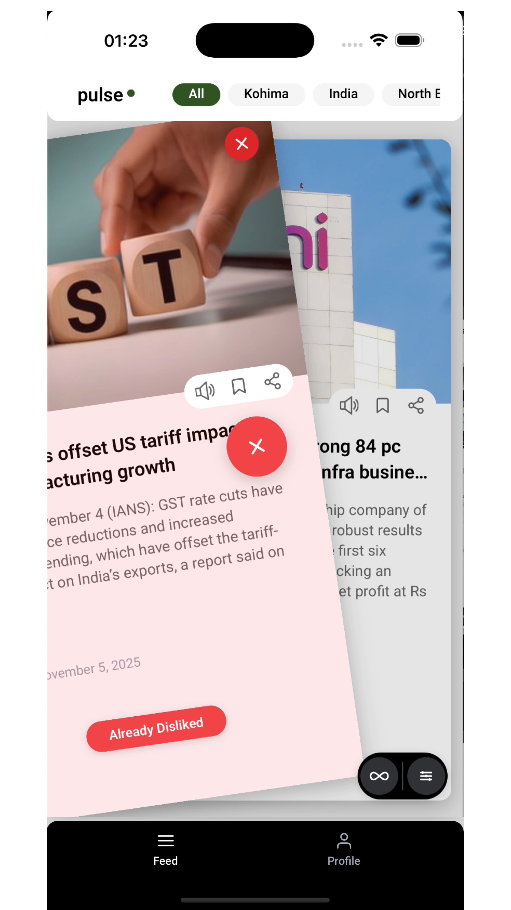
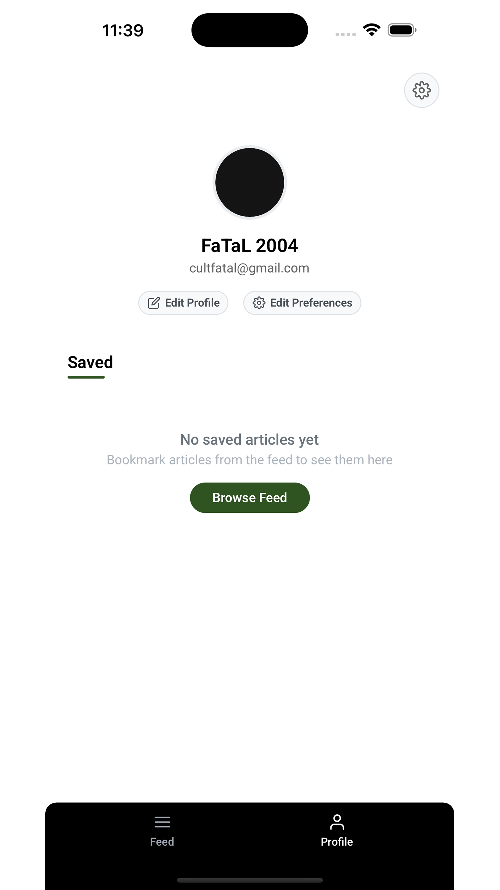
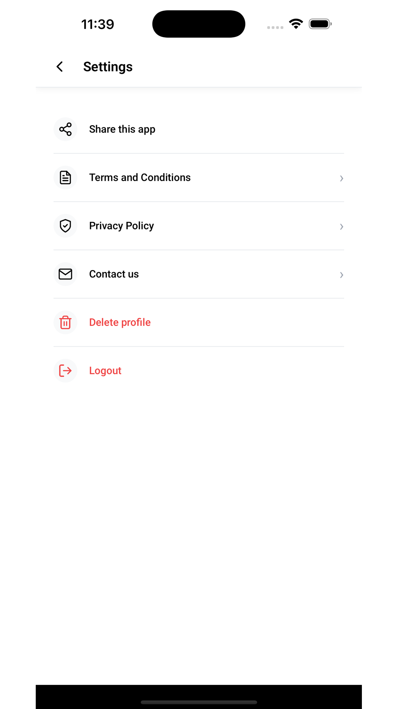

<div align="center">
  

  # Pulse — Your Daily News Companion

  **A fast, swipeable React Native news reader with regional filtering, interest personalization, text-to-speech, and cross-device bookmark sync.**

  <p>
    <a href="https://play.google.com/store/apps/details?id=com.mk2004.pulse&hl=en_IN">
      
    </a>
  </p>

  <p>
    
    
    
    
    
  </p>
</div>

---

## Overview

**Pulse** (`com.mk2004.pulse`) is a mobile news application built with **React Native**, **TypeScript**, and **Firebase**. It delivers concise, full-height swipeable news cards with regional filtering, topic personalization, built-in text-to-speech (TTS), YouTube video embeds, custom deep linking, and offline-capable bookmark syncing across devices.

### Table of Contents

- [Screenshots](#screenshots)
- [Key Features](#key-features)
- [Tech Stack & Architecture](#tech-stack--architecture)
- [Project Structure](#project-structure)
- [Getting Started](#getting-started)
- [Contributing & License](#contributing--license)

---

## Screenshots

| | | |
| :---: | :---: | :---: |
|  |  |  |
|  |  |  |

---

## Key Features

- **📰 Swipeable Card Interface**  
  Full-height, Inshorts-style news cards (`NewsCard` + `FeedScreen`) powered by `PanResponder`—swipe vertically (up/down) to move between articles and horizontally (left/right) to dislike or like.

- **🔊 Text-to-Speech & Video Support**  
  Listen to articles hands-free with built-in TTS playback (`@mhpdev/react-native-speech`) and watch embedded YouTube videos (`react-native-youtube-iframe`) directly within `NewsCard`.

- **📍 Regional News Filtering**  
  Horizontal region filter capsules in `FeedScreen` backed by Firestore `regions` queries (`firebaseService.fetchRegionFilters` with fallback regions: `all`, `north eastern`, `nagaland`, `india`).

- **🎯 Interest Personalization & Categories**  
  Personalize your feed by `userInterests` via `filterNewsByInterests` and update topics anytime in `PreferencesModal` (accessible from Feed and Account screens). Categories are fetched dynamically from Firestore `tags` (with fallback categories including `World`, `India`, `Business`, `Technology`, `Sports`, `Entertainment`, `Science`, `Health`).  
  *(Note: `UserOnboarding` exists in `src/screens/UserOnboarding.tsx` but is not currently registered in `AppNavigator`; `WelcomeScreen` and `AuthScreen` navigate directly to `Feed`.)*

- **🔖 Offline & Cloud-Synced Bookmarks**  
  Save articles from `NewsCard` or `NewsDetailScreen` via `bookmarkService`. Bookmarks are persisted locally in `AsyncStorage` for guest/offline use and synced to Firestore (`users/{uid}/bookmarks`) for signed-in users, with sorting and pagination in `AccountScreen`.

- **👤 Guest Preview & Secure Authentication**  
  Explore the app immediately as a guest via **"Skip for now"** on `WelcomeScreen` with a 4-article free preview limit (prompting `MandatorySignup` on the 5th card). Sign in or register via **Google Sign-In**, **Email/Password** (with password reset), or **Apple Sign-In**, with full sign-out and account deletion support in `firebaseService`.

- **🔗 Deep Linking & Native Sharing**  
  Open specific articles directly using the `pulse://article/:articleId` custom URL scheme (configured in `AppNavigator`, `AndroidManifest.xml`, and `Info.plist`). Share headlines, previews, deep links, and store URLs via native `Share.share` from `FeedScreen`, `NewsDetailScreen`, and `SettingsScreen`.

---

## Tech Stack & Architecture

| Layer | Technologies & Versions |
| --- | --- |
| **Framework & Language** | React Native `0.82.0`, React `19.1.1`, TypeScript `^5.8.3`, Node `>=20` |
| **Backend, Auth & Database** | `@react-native-firebase/app`, `@react-native-firebase/auth`, `@react-native-firebase/firestore` (`^23.4.1`), `@react-native-google-signin/google-signin` (`^16.0.0`), `@invertase/react-native-apple-authentication` (`^2.5.0`) |
| **Navigation & Gestures** | `@react-navigation/native` (`^7.1.18`), `@react-navigation/stack` (`^7.4.10`), `react-native-gesture-handler` (`^2.28.0`), `react-native-safe-area-context` (`^5.6.1`), `react-native-screens` (`^4.17.1`) |
| **Storage, Media & UI** | `@react-native-async-storage/async-storage` (`^2.2.0`), `@mhpdev/react-native-speech` (`^1.3.0`), `react-native-youtube-iframe` (`^2.4.1`), `react-native-video` (`^6.17.0`), `react-native-webview` (`^13.16.0`), `react-native-linear-gradient` (`^2.8.3`), `react-native-svg` (`^15.14.0`), `react-native-copilot` (`^3.3.3`) |
| **Android Build** | Gradle `9.0.0`, Kotlin `2.1.20`, `minSdkVersion 24`, `compileSdkVersion 36`, `targetSdkVersion 36`, Google Services `4.4.4`, `applicationId "com.mk2004.pulse"` |
| **iOS Build** | CocoaPods static frameworks (`use_frameworks! :linkage => :static`, `$RNFirebaseAsStaticFramework = true`), Ruby `>= 2.6.10` |

---

## Project Structure

```text
pulse-main/
├── App.tsx, index.js, app.json, package.json, tsconfig.json
├── README.md, ANDROID_RELEASE_GUIDE.md, Gemfile, Gemfile.lock
├── __tests__/
│   └── App.test.tsx
├── readme-assets/
│   ├── icon.png
│   └── screenshot-1.png ... screenshot-6.png
├── android/
│   ├── app/ (build.gradle, google-services.json, proguard-rules.pro, keystores, src/)
│   └── gradle/, build.gradle, gradle.properties, settings.gradle, keystore.properties
├── ios/
│   ├── GoogleService-Info.plist, Podfile, Podfile.lock
│   └── Pulse/ (AppDelegate.swift, Info.plist, PrivacyInfo.xcprivacy, Pulse.entitlements, Images.xcassets/)
└── src/
    ├── main.tsx
    ├── assets/ (fonts/, html/, icons/, logo.png, *.png)
    ├── components/ (AdCard.tsx, AppTour.tsx, AppleSignInButton.tsx, BottomNavigation.tsx, Button.tsx, Checkbox.tsx, Chip.tsx, EmailSignInButton.tsx, GoogleSignInButton.tsx, Icons.tsx, NewsCard.tsx, SegmentedControl.tsx, SignupModal.tsx, TextField.tsx, WalkthroughOverlay.tsx, WalkthroughScreen.tsx)
    ├── constants/theme.ts
    ├── hooks/useAppTour.ts
    ├── navigation/AppNavigator.tsx
    ├── screens/ (AccountScreen.tsx, AuthScreen.tsx, ContactScreen.tsx, EditProfileScreen.tsx, FeedScreen.tsx, MandatorySignupScreen.tsx, NewsDetailScreen.tsx, PreferencesModal.tsx, PrivacyPolicyScreen.tsx, SettingsScreen.tsx, TermsConditionsScreen.tsx, UserOnboarding.tsx, WelcomeScreen.tsx)
    ├── services/ (bookmarkService.ts, firebaseService.ts, newsService.ts)
    └── types/ (index.ts, svg.d.ts)
```

---

## Getting Started

### Prerequisites

- **Node.js** `>= 20`
- **Watchman** and the [React Native CLI environment](https://reactnative.dev/docs/set-up-your-environment)
- **Android**: Java JDK + Android SDK (`minSdk 24`, `compileSdk 36`)
- **iOS** (macOS): Xcode, Ruby `>= 2.6.10`, Bundler, and CocoaPods

### 1. Install Dependencies

```sh
# Install JavaScript dependencies
npm install
# or
yarn install
```

For **iOS**, install Ruby gems and CocoaPods dependencies:

```sh
bundle install
cd ios && bundle exec pod install && cd ..
```

### 2. Firebase & OAuth Configuration

Firebase configuration (`pulse-c6df9`), Google Sign-In client IDs (`webClientId` / `iosClientId` in `src/services/firebaseService.ts`), `android/app/google-services.json`, and `ios/GoogleService-Info.plist` are already included in the repository (no `.env` setup is required to run with the existing configuration). If you fork the project for your own Firebase backend, replace those files and client IDs with your own.

### 3. Run the App

Start the Metro bundler in one terminal:

```sh
npm start
# or
yarn start
```

In a separate terminal, build and launch on your target platform:

```sh
# Android
npm run android
# or
yarn android

# iOS
npm run ios
# or
yarn ios
```

### 4. Tests & Linting

```sh
# Run Jest tests
npm test

# Run ESLint
npm run lint
```

### 5. Android Release Build

Release builds require `android/keystore.properties` and `android/app/release.keystore`. See [`ANDROID_RELEASE_GUIDE.md`](./ANDROID_RELEASE_GUIDE.md) for full keystore and signing instructions.

```sh
cd android
./gradlew assembleRelease   # Build release APK
./gradlew bundleRelease     # Build release AAB (Play Store)
```

---


